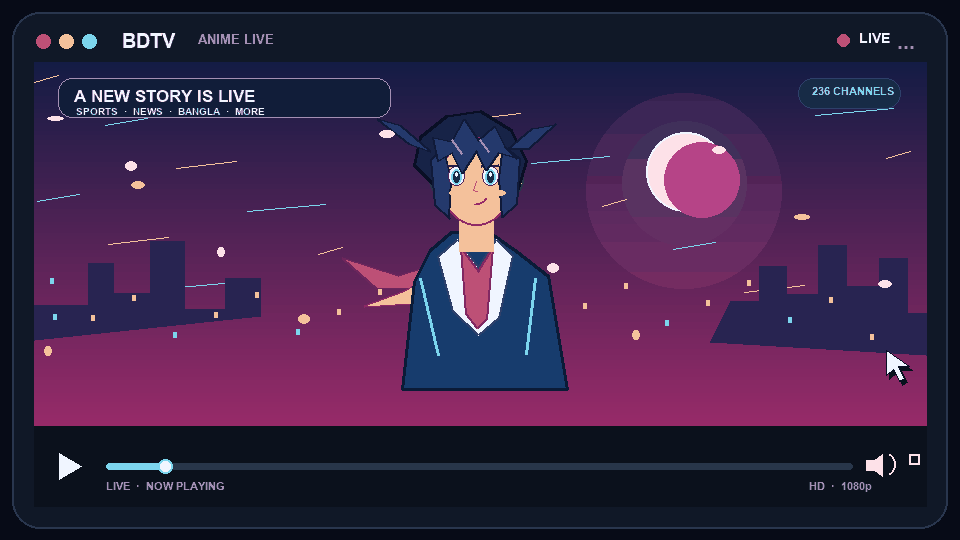

# 📺 BDTV · LIVE

### Your channels. One playlist.

 

 

## ⚡ Quick playlist link

### https://is.gd/ijN81u

Open the link in an M3U-compatible player to load the playlist.

---

## ✨ What's inside

One playlist with **236 channels**, organized into:

`Sports` · `News` · `Bangla` · `Movies` · `Kids` · `Music` · `Religious` · `International`

## ▶️ How to use

1. Copy **https://is.gd/ijN81u**.
2. Open a media player that supports M3U playlists.
3. Choose **Open Network Stream** (or the equivalent) and paste the link.

The short link redirects to [`playlists/live.m3u`](https://raw.githubusercontent.com/kauserahamed424-debug/HDTV/main/playlists/live.m3u).

---

Made for the love of live TV · Use streams only where you have permission to access them.

